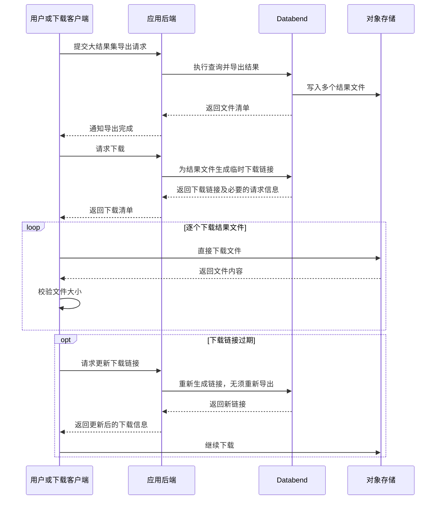

`COPY INTO` 将文件写入 Stage 或外部存储。如果需要保存到本地，还需要单独下载。

## 导出并找到文件

使用尚未占用的 Stage 名称：

```sql
CREATE STAGE export_stage;

COPY INTO @export_stage
FROM (SELECT * FROM generate_series(1, 100))
FILE_FORMAT = (TYPE = PARQUET)
DETAILED_OUTPUT = TRUE;

LIST @export_stage;
```

导出结果包含 `file_name`、`file_size` 和 `row_count`。将下面的 `<file_name>` 替换为相对于 Stage 的实际文件路径。

## 获取下载 URL

```sql
PRESIGN DOWNLOAD @export_stage/<file_name> EXPIRE = 7200;
```

[PRESIGN](/sql/sql-commands/ddl/stage/presign) 返回 `method`、`headers` 和 `url`。此示例请求的链接有效期为 7,200 秒，但存储凭证可能更早过期。

### 使用浏览器下载

对于 `GET` 请求，检查返回的 `headers`：

- **`headers = {}`**：不需要额外请求头。将完整 URL（包括查询字符串）粘贴到浏览器地址栏。浏览器可能下载文件，也可能直接展示内容；如果展示内容，使用浏览器的保存功能。
- **`headers` 不为空**：需要携带返回的请求头名称和值。浏览器地址栏无法添加这些请求头，应改用 cURL 或 HTTP 客户端。

`headers` 为空不表示文件是公开的。URL 包含临时授权，不要公开分享或写入日志。链接过期后，需要重新生成。

### 使用 cURL 下载

当 `headers` 为 `{}` 时：

```bash
curl --fail --location --output export.parquet '<presigned-url>'
```

如果 `headers` 包含内容，为每个返回项添加 `--header '<header-name>: <header-value>'`。URL 应保留引号，因为其中可能包含 `&` 等 Shell 特殊字符。使用尚未占用的本地输出路径。

## 其他下载方式

| 方式                                                      | 用途                                                                                                                                             |
| --------------------------------------------------------- | ------------------------------------------------------------------------------------------------------------------------------------------------ |
| [BendSQL GET](../40-load-data/00-stage/02-stage-files.md) | 在命令行下载 Stage 文件。`GET` 是 BendSQL 命令，不是可通过 JDBC 执行的服务端 SQL。                                                               |
| [Java (JDBC)](/developer/drivers/jdbc)                    | 使用 Databend 驱动的 `downloadStream()` 扩展将 Stage 文件复制到磁盘，使用后关闭流。需要自定义 HTTP 处理时，可通过 JDBC 执行 `PRESIGN DOWNLOAD`。 |
| 对象存储客户端或 SDK                                      | 使用存储服务的传输工具，下载导出到自有外部存储的文件。                                                                                           |
| [READ_FILE](/sql/sql-functions/other-functions/read-file) | 将 Stage 文件内容读取为 SQL `BINARY` 值，供查询处理。                                                                                            |

在 Databend Cloud 上，通过 `READ_FILE()` 下载文件会产生流量费，不推荐用于下载大文件。建议改用预签名 URL 下载。

## 大文件注意事项

大结果集导出为多个文件时，分别下载即可。下载后，将本地文件大小与导出结果中的 `file_size` 比较。

通过应用管理导出和下载时，流程如下：


