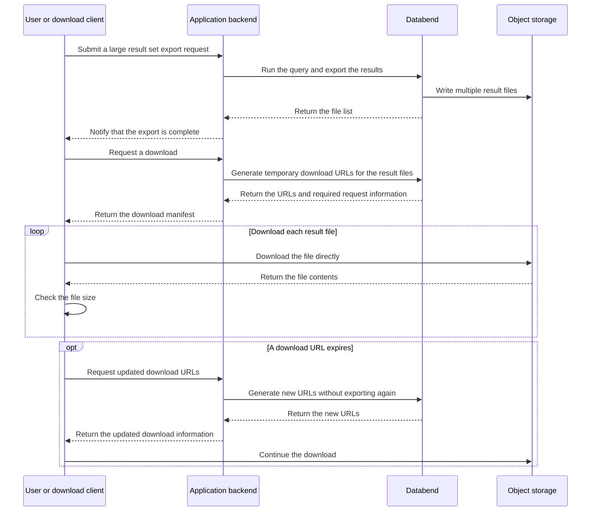

`COPY INTO` writes files to a stage or external storage. Download the files separately to save them on your computer.

## Export and Locate Files

Use an unused stage name:

```sql
CREATE STAGE export_stage;

COPY INTO @export_stage
FROM (SELECT * FROM generate_series(1, 100))
FILE_FORMAT = (TYPE = PARQUET)
DETAILED_OUTPUT = TRUE;

LIST @export_stage;
```

The export result includes `file_name`, `file_size`, and `row_count`. Replace `<file_name>` below with the actual stage-relative file path.

## Get a Download URL

```sql
PRESIGN DOWNLOAD @export_stage/<file_name> EXPIRE = 7200;
```

[PRESIGN](/sql/sql-commands/ddl/stage/presign) returns `method`, `headers`, and `url`. This example requests a link that is valid for 7,200 seconds. Storage credentials can expire sooner.

### Download in a Browser

For a `GET` request, check the returned `headers`:

- **`headers = {}`**: No extra request headers are needed. Copy the full URL, including its query string, into the browser address bar. The browser downloads or displays the file. If it displays the file, use the browser's save function.
- **`headers` is not empty**: Send the returned header names and values with the request. The browser address bar cannot add these headers. Use cURL or an HTTP client instead.

An empty `headers` value does not mean that the file is public. The URL contains temporary authorization. Do not share it publicly or write it to logs. Generate a new URL if it expires.

### Download with cURL

When `headers` is `{}`:

```bash
curl --fail --location --output export.parquet '<presigned-url>'
```

If `headers` contains entries, add `--header '<header-name>: <header-value>'` for each entry. Keep the URL in quotes because it can contain shell characters such as `&`. Use a new local output path.

## Other Download Methods

| Method                                                    | Use                                                                                                                                                                                  |
| --------------------------------------------------------- | ------------------------------------------------------------------------------------------------------------------------------------------------------------------------------------ |
| [BendSQL GET](../40-load-data/00-stage/02-stage-files.md) | Download staged files from the command line. `GET` is a BendSQL command, not server SQL that you can execute through JDBC.                                                           |
| [Java (JDBC)](/developer/drivers/jdbc)                    | Use the Databend driver's `downloadStream()` extension to copy a staged file to disk. Close the stream after use. For custom HTTP handling, execute `PRESIGN DOWNLOAD` through JDBC. |
| Object storage client or SDK                              | Download files exported to your own external storage, using that provider's transfer tools.                                                                                          |
| [READ_FILE](/sql/sql-functions/other-functions/read-file) | Read staged file contents as a SQL `BINARY` value for query processing.                                                                                                              |

In Databend Cloud, downloading files through `READ_FILE()` incurs data transfer charges. It is not recommended for large file downloads. Use a pre-signed URL instead.

## Large Files

For large exports, download the output files separately. Compare each local file size with `file_size` from the export result.

For application-managed exports and downloads, use this flow:


